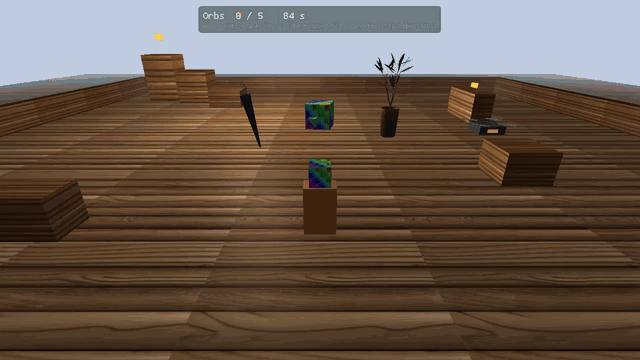
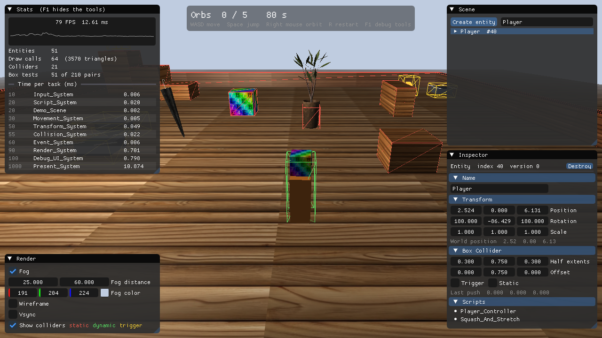
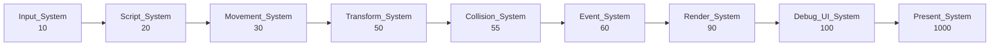

# ECS Engine

[](https://github.com/miguelrg14/ECS_Engine/actions/workflows/build.yml)

A small game engine written from scratch in **C++20 and OpenGL 3.3 (Core Profile)**, built around a data-oriented **Entity Component System**, with a playable demo, live debug tools and unit tests.

<p align="center">
  
</p>

It revisits the final assignment of the *Graphics Engines and Plugins* course (Game Design & Development degree): a task kernel, an entity/component subsystem and a messaging subsystem, split into an `Engine` static library and a `Game` executable. This version replaces the object-oriented entity model of the original assignment with a real ECS, and draws with my own renderer from [VS_3D-Renderer](https://github.com/miguelrg14/VS_3D-Renderer).

**[Download the latest build](https://github.com/miguelrg14/ECS_Engine/releases/latest)** (Windows x64, unzip and run `ECS_Engine.exe`).

---

## Features

| Area | What it does |
|---|---|
| **ECS core** | Entities are 32-bit IDs with a generation counter. One sparse-set pool per component type: O(1) add, remove and lookup, components packed contiguously. `view<A, B>()` walks the rarest component first. |
| **Task kernel** | Systems run in priority order every frame, with a clamped delta time and per-task timing. Tasks added or removed mid-frame are applied at the next frame. |
| **Transforms** | Position, quaternion rotation and scale with parent/child hierarchy; world matrices resolved once per frame in any creation order. |
| **Renderer** | OpenGL 3.3 Core: shaders with cached uniforms, interleaved meshes, mipmapped textures, materials shared between entities, Blinn-Phong lighting and distance fog. Independent of the ECS. |
| **Scripts** | Gameplay logic as C++ classes attached to entities (`on_create`, `on_update`, `on_destroy`), several per entity, deferred destruction. |
| **Events** | Typed publish/subscribe: any struct is an event, delivered once per frame; subscribing and unsubscribing from inside a handler is safe. |
| **Collisions** | Axis-aligned box colliders (static, dynamic, trigger), sweep-and-prune broad phase, separation along the least-penetration axis, enter/exit events. |
| **Debug tools** | Dear ImGui (F1): frame-time graph and time per system, scene hierarchy, live component inspector, render settings, collider boxes. |
| **Tests and CI** | 51 unit tests run after every build; GitHub Actions builds Debug and Release with Visual Studio 2026 on every push. |

<p align="center">
  
  <br><em>Debug tools: time per system, live inspector, collider boxes</em>
</p>

---

## The demo

Collect the 5 orbs in the arena within 90 seconds. Patrolling drones send you back to the start; one orb waits on top of the crate stairs.

| Input | Action |
|---|---|
| `W` `A` `S` `D` | Move (relative to the camera) |
| `Shift` (hold) | Run |
| `Space` | Jump |
| Right mouse (hold) + move | Orbit the camera |
| Mouse wheel | Zoom |
| `R` | New round |
| `F1` | Show / hide the debug tools |
| `Tab` | Free fly camera (`W` `A` `S` `D` + `Q` / `E`, right mouse to look) |
| `C` | Add / remove 1,000 spinning cubes (stress test) |
| `L` / `F` / `X` / `V` | Pause light / fog / wireframe / vsync |
| `Esc` | Quit |

---

## How a frame runs



Every box is a `Task` registered in the `Kernel` with its priority. Scripts move things, transforms are resolved, collisions push solids apart and queue trigger events, events are delivered, and only then is the frame drawn, so what you see is always consistent with that frame's logic.

---

## The code at a glance

A scene object is an entity with components; the engine's systems do the rest:

```cpp
engine::Entity cube = registry.create ();
registry.add< engine::Transform     >(cube).position = { 0.f, 1.2f, 0.f };
registry.add< engine::Mesh_Renderer >(cube, cube_mesh, checker_material);
registry.add< engine::Velocity      >(cube, glm::vec3(0.f), glm::vec3(0.f, 0.8f, 0.f));   // spins
registry.add< engine::Box_Collider  >(cube);                                                // solid

engine::Entity moon = registry.create ();
registry.add< engine::Transform     >(moon).parent = cube;                                  // orbits with it
```

Systems are loops over the components they need:

```cpp
registry.view< Transform, Velocity >().each ([dt] (Transform & transform, Velocity & velocity)
{
    transform.position += velocity.linear * dt;
});
```

Behaviour goes in scripts, which talk through events without knowing each other:

```cpp
struct Landed { engine::Entity entity; float impact_speed; };          // any struct is an event

class Player_Controller : public engine::Script
{
    void on_update (float dt) override
    {
        // ... move, jump, fall ...
        if (just_landed) publish (Landed{ entity (), fall_speed });
    }
};

class Squash_And_Stretch : public engine::Script
{
    void on_create () override
    {
        subscribe< Landed >([this] (const Landed & event) { if (event.entity == entity ()) squash (event.impact_speed); });
    }
};

registry.add< engine::Script_Component >(player).bind< Player_Controller >(camera);
registry.get< engine::Script_Component >(player).bind< Squash_And_Stretch >();
```

---

## Design decisions

- **Sparse sets instead of objects with component maps.** The original assignment stored components in `std::map<std::string, std::shared_ptr<Component>>` per entity. Here components of one type are packed in one array, found by C++ type at compile time instead of by string, and systems walk only the entities that have what they need.
- **The renderer knows nothing about entities.** `Render_System` is the only place where the ECS meets OpenGL; the renderer can be tested or reused without the ECS.
- **Typed, queued events.** A typo in an event name is a compile error, and handlers run at a fixed point of the frame instead of in the middle of the sender's update.
- **Own collision system instead of a physics library.** The demo needs blocking, standing on platforms and trigger zones, not rigid-body simulation, so about 250 lines of tested code are enough. A Bullet-based `Physics_System` is the next planned step and fits behind the same components and events.
- **Tests on every build.** A failing test fails the build locally and on GitHub.

Full write-up of each part in **[docs/architecture.md](docs/architecture.md)**.

---

## Building

**Requirements:** Windows 10/11 x64, Visual Studio 2026 with *Desktop development with C++* (toolset v145), a GPU with OpenGL 3.3.

```text
1. git clone https://github.com/miguelrg14/ECS_Engine.git
2. Open ECS_Engine.sln
3. Select x64 and Debug or Release
4. Press F5
```

`Game` is the startup project and builds `Engine` first. Building the solution also builds and runs `Tests`. Everything the engine needs is in [`libraries/`](libraries/); there is nothing to install. Details and troubleshooting in **[docs/building.md](docs/building.md)**.

### Project layout

```text
ECS_Engine/
├── ECS_Engine.sln
├── props/Common.props        # settings shared by every project (C++20, /W4, paths)
├── Engine/                   # static library: core/, ecs/, components/, systems/, scripting/, events/, renderer/, resources/
├── Game/                     # the demo: scene, gameplay scripts, assets and shaders
├── Tests/                    # unit tests, run after every build
├── libraries/                # third-party code, each with its license
├── docs/                     # architecture, building, images
└── .github/workflows/        # Windows build, tests and releases
```

### Tech stack

| Library | Use |
|---|---|
| [SDL2](https://www.libsdl.org/) 2.30.9 | Window, OpenGL context, input |
| [GLAD](https://glad.dav1d.de/) 0.1.36 | OpenGL 3.3 Core loader (compiled from source) |
| [GLM](https://github.com/g-truc/glm) 1.0.1 | Vectors, matrices, quaternions |
| [stb_image](https://github.com/nothings/stb) 2.34 | Image decoding (header-only) |
| [tinyobjloader](https://github.com/tinyobjloader/tinyobjloader) 2.0.0rc13 | .obj loading (header-only) |
| [Dear ImGui](https://github.com/ocornut/imgui) 1.93.0 | Debug tools and HUD |

---

## Roadmap

| Phase | Goal | Status |
|---|---|---|
| 1 · Solution skeleton | `Engine` library + `Game` executable, SDL2 window, OpenGL 3.3 context | ✅ |
| 2 · Kernel, timer, input | Priority-ordered tasks, frame timer, keyboard and mouse state | ✅ |
| 3 · Renderer module | Shaders, meshes, textures, materials, resource cache, .obj models | ✅ |
| 4 · ECS core | Sparse-set pools, registry, views, unit tests | ✅ |
| 5 · Components and systems | Transform hierarchy, camera, light, movement and render systems | ✅ |
| 6 · Scripts and events | Native scripts, typed event bus, player controller | ✅ |
| 7 · Collisions and demo | Box colliders and triggers, the orb arena | ✅ |
| 8 · Debug tools and release | Dear ImGui tools, CI, packaged build, documentation | ✅ |
| Next · Physics | Optional Bullet `Physics_System` with rigid bodies, behind the same components and events | Planned |

---

## Credits

- Umbrella and plant models, their textures, and the wood and UV-checker textures: from my [VS_3D-Renderer](https://github.com/miguelrg14/VS_3D-Renderer) assignment, as is the Blinn-Phong and fog shader this engine's lit shader is ported from.
- Third-party libraries listed above, each under its own license in `libraries/`.

## License

My code is released under the [MIT License](LICENSE).
