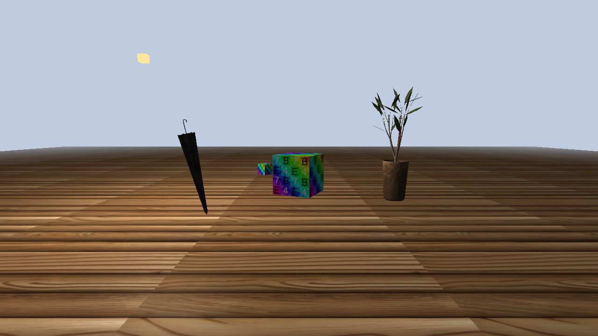

# ECS Engine

A small game engine written from scratch in **C++20 and modern OpenGL 3.3 (Core Profile)**, built around a data-oriented **Entity Component System**.

It revisits the final assignment of the *Graphics Engines and Plugins* course (Game Design & Development degree): a task kernel, an entity/component subsystem and a messaging subsystem, split into an `Engine` static library and a `Game` executable. This version replaces the object-oriented entity model with a real ECS (entities as IDs, components stored contiguously per type, systems that iterate over views) and draws with my own renderer from [VS_3D-Renderer](https://github.com/miguelrg14/VS_3D-Renderer).

> **Status:** phase 3 of 8. The renderer module draws textured .obj models with Blinn-Phong lighting and fog. Entities come in phase 4. See the [roadmap](#roadmap).

<p align="center">
  
  <br><em>Phase 3 · renderer test scene</em>
</p>

---

## Roadmap

| Phase | Goal | Status |
|---|---|---|
| 1 · Solution skeleton | `Engine` static library + `Game` executable, SDL2 window, OpenGL 3.3 context through GLAD | ✅ Done |
| 2 · Kernel, timer, input | Priority-ordered systems with `initialize` / `execute(dt)` / `finalize`, frame timer, keyboard and mouse state | ✅ Done |
| 3 · Renderer module | Shaders, meshes, textures and materials ported from VS_3D-Renderer, resource cache, .obj models | ✅ Done |
| 4 · ECS core | Sparse-set component pools, `Registry`, `view<A, B>()`, unit tests | ⏳ |
| 5 · Core components and systems | Transform hierarchy, camera, lights, render system | ⏳ |
| 6 · Scripts and events | Native scripts, typed event bus, player controller | ⏳ |
| 7 · Collisions and demo | AABB colliders and triggers, small playable demo | ⏳ |
| 8 · Debug tools and release | Dear ImGui entity inspector, docs, packaged build | ⏳ |

---

## Project layout

```text
ECS_Engine/
├── ECS_Engine.sln
├── props/Common.props        # settings shared by every project (C++20, /W4, paths)
├── Engine/                   # static library
│   ├── project/Engine.vcxproj
│   └── code/
│       ├── headers/          # core/, renderer/ (ecs/, systems/... in later phases)
│       └── sources/
├── Game/                     # executable built on top of the engine
│   ├── project/Game.vcxproj
│   ├── code/
│   └── assets/
├── libraries/                # third-party headers and prebuilt libraries
└── docs/
```

More detail in [docs/architecture.md](docs/architecture.md).

---

## Tech stack

| Library | Use |
|---|---|
| [SDL2](https://www.libsdl.org/) 2.30.9 | Window, OpenGL context, input |
| [GLAD](https://glad.dav1d.de/) 0.1.36 | OpenGL 3.3 Core function loader (compiled from source into `Engine`) |
| [GLM](https://github.com/g-truc/glm) 1.0.1 | Vectors, matrices, transforms |
| [stb_image](https://github.com/nothings/stb) 2.34 | PNG / JPG / TGA / BMP decoding (header-only) |
| [tinyobjloader](https://github.com/tinyobjloader/tinyobjloader) | Wavefront .obj loading (header-only) |

All dependencies are **included in [`libraries/`](libraries/)**, so there is nothing to install. The SDL2 binaries are small enough to live in the repository directly, so Git LFS is not needed.

---

## Quick start

**Requirements:** Windows 10/11 x64, Visual Studio 2026 with the *Desktop development with C++* workload (platform toolset v145), and a GPU that supports OpenGL 3.3.

```text
1. git clone https://github.com/miguelrg14/ECS_Engine.git
2. Open ECS_Engine.sln
3. Select x64 and Debug or Release
4. Press F5
```

`Game` is the startup project and depends on `Engine`, so both build in order. The executable is written to `binaries/<Configuration>/ECS_Engine.exe` together with `SDL2.dll` and `assets/`.

See **[docs/building.md](docs/building.md)** for details and troubleshooting.

### Controls

The current build is the phase 3 renderer test scene:

| Input | Action |
|---|---|
| Right mouse (hold) + move | Look around |
| `W` `A` `S` `D` | Move |
| `Q` / `E` | Down / up |
| `Shift` (hold) | Move faster |
| `L` | Pause / resume the light |
| `F` | Toggle fog |
| `X` | Toggle wireframe |
| `V` | Toggle vsync |
| `Esc` | Quit |

The window title shows FPS, frame time, draw calls and triangles.

---

## Credits

- Umbrella and plant models and their textures, wood and UV-checker textures: from my [VS_3D-Renderer](https://github.com/miguelrg14/VS_3D-Renderer) assignment.
- The lit shader is a port of the Blinn-Phong and fog shader from the same project.

## License

My code is released under the [MIT License](LICENSE). Third-party libraries in `libraries/` keep their own licenses, included next to each one.
